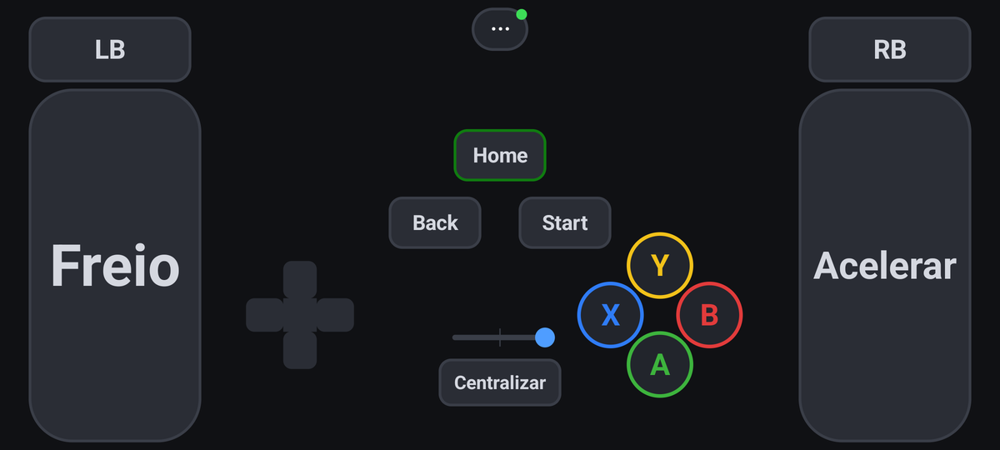
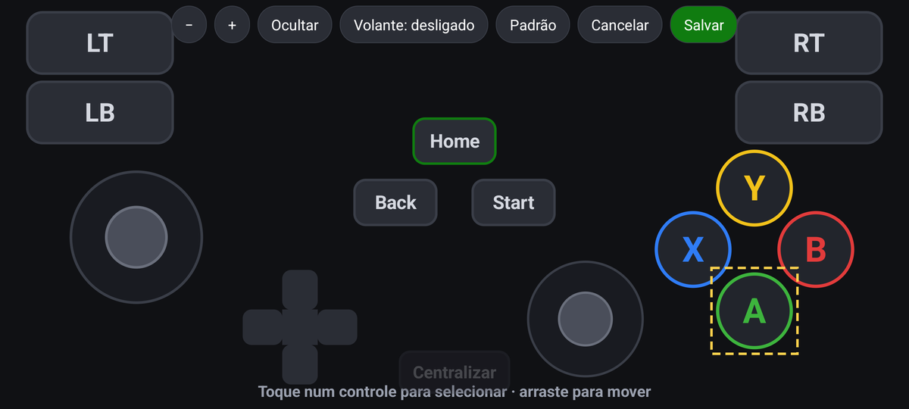
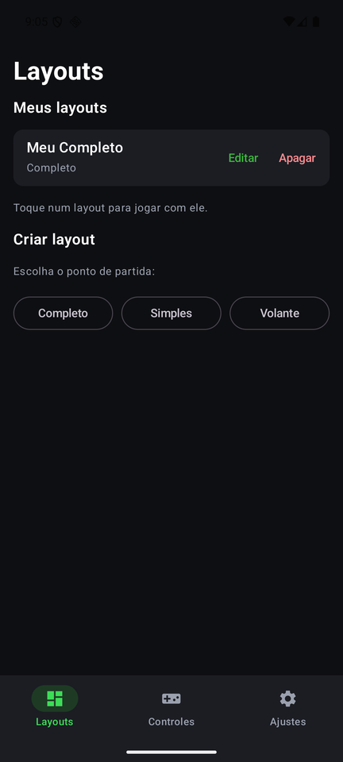
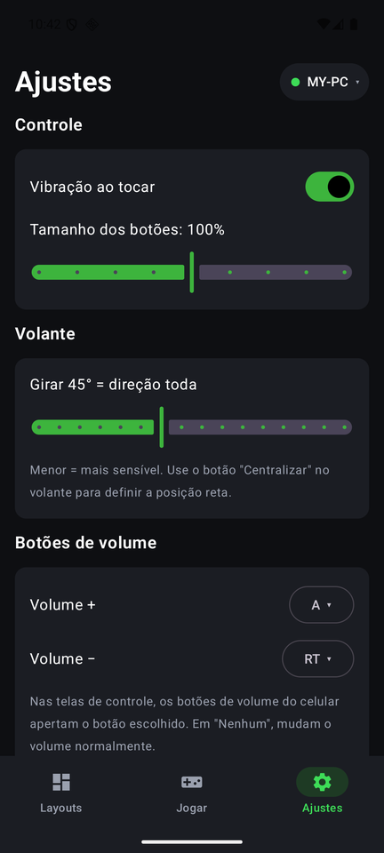
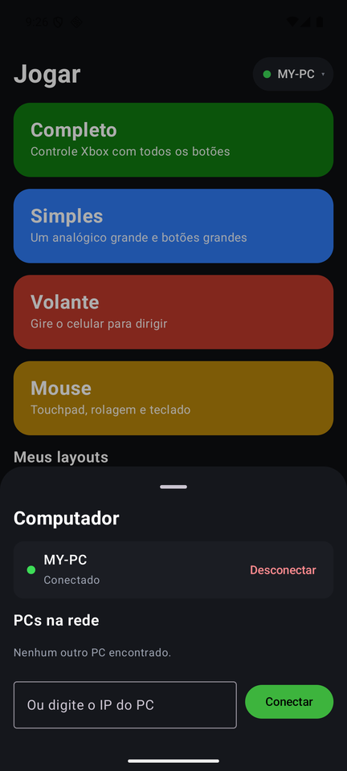
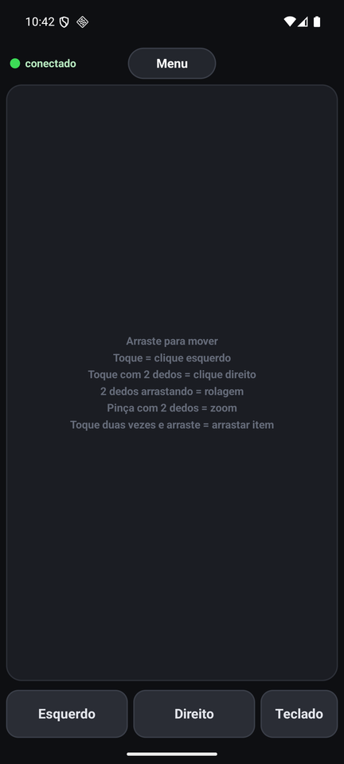

<p align="center">
  
</p>

<h1 align="center">EasyJoy</h1>

<p align="center">
  Turn your Android phone into an <b>Xbox controller</b>, a <b>steering wheel</b> or a <b>touchpad + keyboard</b> for your Windows PC — over your home Wi-Fi.
</p>

<p align="center">
  <a href="https://github.com/kadmielp/EasyJoy/releases/latest"><b>⬇ Download the APK and the PC app</b></a>
</p>

<p align="center">
  
</p>

Games and emulators see a regular **Xbox 360 controller** — no per-game setup. The phone finds the PC by itself; no IP typing.

> The app is in English, Portuguese and Spanish. The phone app follows the phone's language (change it in *Settings → Language*); the PC app follows the Windows display language.

## Features

| | |
|---|---|
| **Full controller** — two sticks, d-pad, ABXY, LB/RB/LT/RT, Back/Start/Home |  |
| **Simple** — one big stick (also works as d-pad) and big ABXY, made for retro emulators |  |
| **Steering wheel** — hold the phone in landscape and turn it like a wheel (or lift one side). Big brake (LT) and throttle (RT) pedals, your thumbs still reach the buttons. Steering goes to the left stick, which every racing game understands. |  |
| **Layout editor** — in the *Layouts* tab pick a starting point (or tap *Editar* inside a controller), then drag any control, resize it (−/+), hide it, turn tilt steering on for any layout, and save it with a name. |  |

The app has three tabs at the bottom, and the PC you're connected to is always shown at the top (tap it to switch PCs or type an IP):

<table>
<tr>
<td align="center"><br><b>Jogar</b> — every mode and your own layouts, one tap to play</td>
<td align="center"><br><b>Layouts</b> — create, edit, duplicate or delete layouts</td>
<td align="center"><br><b>Ajustes</b> — vibration, button size, steering, mouse</td>
<td align="center"><br><b>PC picker</b> — finds your PC automatically</td>
</tr>
</table>

<table>
<tr>
<td align="center"><br><b>Mouse</b> — touchpad, scrolling and keyboard</td>
<td align="center"><br><b>PC app</b> — shows connected phones and their mode</td>
</tr>
</table>

**Mouse mode:** works like a laptop touchpad. Drag to move · tap = left click · two-finger tap = right click · two-finger drag = scroll · double-tap and drag = drag items · pinch = zoom (Ctrl + wheel) · two-finger flick keeps scrolling and slows down · *Teclado* opens the phone keyboard to type on the PC.

**Settings:** vibration on touch, mouse sensitivity, button size (80–120%), how far you turn for full steering (15–90°), the phone's **volume keys** as controller buttons (e.g. Volume + = RT, Volume − = LT; the on-screen button lights up while you hold the key), and turning gyroscope motion for emulators on or off.

**Motion (gyroscope) for emulators:** on the controller screens the phone also streams its gyroscope and accelerometer. The PC app serves them as a **DSU / Cemuhook** server on `127.0.0.1:26760`, the motion source that Eden, Cemu, Dolphin, Citra and Ryujinx support. Buttons and sticks still come from the Xbox controller; only motion goes over DSU. In Eden, check that *Controls → Advanced → Motion / Touch* lists the server `127.0.0.1:26760` (it's the default). Then click **Motion 1** and move the phone. In Dolphin, open *Alternate Input Sources*, enable **DSU Client** and add `127.0.0.1` port `26760`. A `DSUClient/…` device then shows up; point the Accelerometer and Gyroscope fields of *Motion Input* at it and keep the Xbox controller as the main device. The phone only turns its sensors on while an emulator is listening, and the PC app shows a green *Gyroscope* tag next to the phone while motion is flowing.

## Quick start

1. **PC (Windows 10/11):** download and run `EasyJoy.exe`. Nothing to install.
   - When Windows asks about the firewall, allow **Private networks**.
   - The virtual controller needs the [ViGEmBus driver](https://github.com/nefarius/ViGEmBus/releases/latest). The app tells you if it's missing. Mouse mode works without it.
2. **Phone (Android 8+):** install `EasyJoy.apk` (allow installing from unknown sources when asked).
3. Put both on the **same Wi-Fi**, open EasyJoy on the phone and tap your PC's name (it shows up on the **Jogar** tab).
4. In the **Jogar** tab pick **Completo**, **Simples**, **Volante**, **Mouse** or one of your own layouts.

Closing the PC window keeps EasyJoy in the system tray; right-click the tray icon → *Sair* to quit. *Iniciar com o Windows* starts it with Windows.

## Troubleshooting

- **The phone doesn't find the PC.** Same Wi-Fi? In the PC app click *Liberar no Firewall* (it also removes old "block" rules Windows creates if the firewall prompt was dismissed). Make sure the Wi-Fi network is set to **Private** in Windows. As a fallback, type the IP shown in the PC app.
- **"Driver de controle não instalado".** Install [ViGEmBus](https://github.com/nefarius/ViGEmBus/releases/latest) and reopen EasyJoy.
- **Home opens "Get an app to open this 'ms-gamebar' link".** That's Windows: the Xbox Home/Guide button opens Xbox Game Bar. Install Game Bar, or turn it off in *Settings → Gaming → Xbox Game Bar*.
- **Steering pulls to one side.** Hold the phone straight and tap *Centralizar*. Too twitchy or too slow? Change *Girar N°* in the *Ajustes* tab.
- **The mouse doesn't work in a program running as administrator.** Windows blocks that; run EasyJoy as administrator too.

## Security

EasyJoy accepts input from any device on the same network while it's open (no pairing). Use it on your home network, not on public Wi-Fi.

## How it works

```
Android app ──UDP 47820 (Wi-Fi)──▶ EasyJoy.exe ──▶ ViGEmBus virtual Xbox 360 pad
   (Kotlin)                          (C# .NET 8)  └─▶ SendInput mouse / keyboard
```

- Discovery is a UDP broadcast; the PC answers with its name. The phone pings every second and shows *desconectado* after 3 s without an answer.
- The gamepad state is sent on every change and every 50 ms. If the phone goes quiet for 3 s (or leaves the controller screen), the PC releases everything.
- Clicks and key presses are sent three times and de-duplicated, so a lost Wi-Fi packet doesn't lose a click.
- The full protocol and design decisions are in [docs/design.md](docs/design.md).

## Building from source

**PC app** (`pc/`, needs the .NET 8 SDK):

```powershell
cd pc
dotnet publish -c Release -o out   # out/EasyJoy.exe, single self-contained file
```

End-to-end test (with `EasyJoy.exe` running and ViGEmBus installed): `python pc/tests/e2e_fake_phone.py`.

**Android app** (`android/`, needs JDK 21 and the Android SDK):

```powershell
cd android
./gradlew testDebugUnitTest assembleDebug
```

Release builds are signed with a key read from `android/keystore.properties` (not in the repo). Create your own keystore and that file to build a signed release.

## Project layout

```
android/   Android app (Kotlin, Jetpack Compose menu + Canvas-drawn controllers)
pc/        Windows app (C# WinForms tray app, ViGEm + SendInput)
docs/      design.md (protocol, decisions) and README images
```
